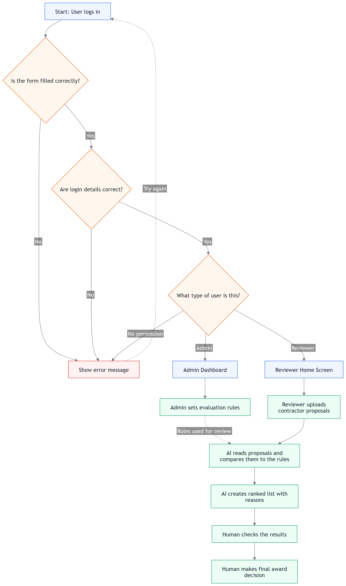
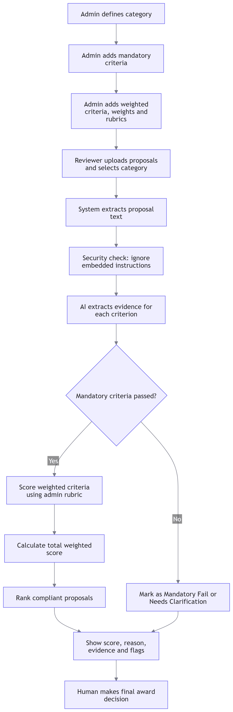
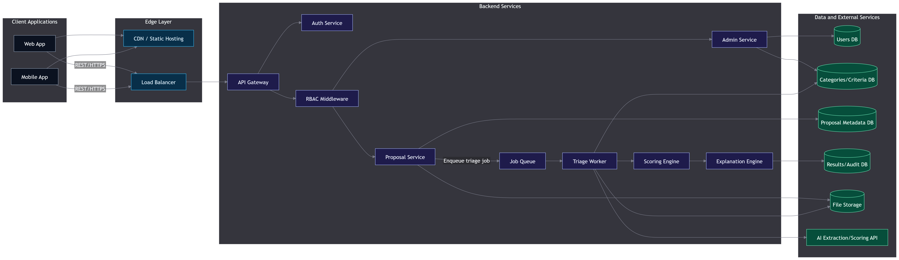
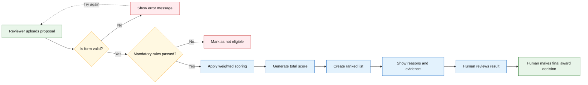

<!-- Place this README.md in: C:\Users\syedb\Desktop\New folder -->

<div align="center">

# AI-Assisted Proposal Triage Submission


<br />

[](https://git.io/typing-svg)

</div>

---

## Candidate Details

| Field | Details |
|---|---|
| **Full Name** | Syed Badi uz Zaman |
| **Reference** | MATACS-TH-2026-02 |
| **Time Actually Spent** | Approximately 6 hours <!-- Change if needed --> |
| **Submission Type** | AI-Assisted Proposal Triage Tool Design |
| **Final Decision** | Human-in-the-loop |

---

## Project Overview

This repository contains the design and explanation for an **AI-assisted proposal triage tool**.

The tool helps a facilities or procurement team compare contractor proposals using admin-defined criteria.

The system follows a simple rule-based flow:

```text
Upload proposals
    ↓
Check mandatory rules
    ↓
Score weighted criteria
    ↓
Generate ranked list
    ↓
Human makes final award decision
```

The AI is used only to help extract and explain proposal information.  
The final scoring, ranking, and award decision are controlled by rules and human review.

---

## Repository Files

| File / Folder | Description | Link |
|---|---|---|
| `ranking.json` | Final ranked result output | [Open ranking.json](./ranking.json) |
| `WRITEUP.md` | Detailed Answers explanation | [Open WRITEUP.md](./WRITEUP.md) |
| `PROMPTS.md` | Prompts Used Explain| [Open PROMPTS.md](./PROMPTS.md) |
| `diagram/` | Folder containing all diagrams | [Open diagram folder](./diagram) |
| `proposal-triage-prototype/` | Folder containing ptototype | [Open prototype folder](./proposal-triage-prototype) |
| `Detail_Low_Level_DFD` | Detailed low-level data flow diagram | [Open Detail Low-Level DFD](./diagram/Detail_Low_Level_DFD.png) |
| `process_flow_diagram` | Simple process flow diagram | [Open Process Flow Diagram](./diagram/process_flow_diagram.png) |
| `Evaluation_Flowchart` | Current Admin_Eval flowchart | [Open  Flowchart](./diagram/Evaluation_FlowChart.png) |
| `System_Architecture_Flowchart` | System architecture flowchart | [Open System Architecture Flowchart](./diagram/System_Architecture_Flowchart.png) |

---

## Folder Structure

```text
matacs-th-2026-02/
│
├── README.md
├── ranking.json
├── WRITEUP.md
│
└── diagram/
    ├── Detail_Low_Level_DFD.png
    ├── process_flow_diagram.png
    └── System_Architecture_Flowchart.png
    └── Evaluation_FlowChart.png
└── proposal-triage-prototype/
    │
    ├── README.md
    ├── requirements.txt
    │
    ├── backend/
    │   ├── __init__.py
    │   ├── main.py
    │   ├── pipeline.py
    │   └── proposals.py
    │
    └── frontend/
        ├── index.html
        ├── style.css
        └── app.js
```

---

## Diagrams

### 1. Detail Low-Level DFD

This diagram shows the detailed movement of data between users, screens, frontend, backend, database, and external AI services.

[Open Detail Low-Level DFD](./diagram/Detail_Low_Level_DFD.png)


---

### 2. Process Flow Diagram

This diagram shows the simple business process from upload to final ranked output.

[Open Process Flow Diagram](./diagram/process_flow_diagram.png)



---
### 2. Current Eval Flow Diagram

This diagram shows the simple business process from upload to final ranked output.

[Open Process Flow Diagram](./diagram/Evaluation_FlowChart.png)



---

### 3. System Architecture Flowchart

This diagram shows the overall system architecture, including frontend, backend, AI extraction, scoring engine, storage, and human decision step.

[Open System Architecture Flowchart](./diagram/System_Architecture_Flowchart.png)



---

## Simple Rule-Based Data Flow

The following flow shows how the system processes a proposal using simple business rules.



---

## Core Rule-Based Logic

The proposed system uses clear business rules:

### Mandatory Rules

```text
1. Ontario electrical contractor licence must be stated.
2. WSIB clearance and $5M liability insurance must be confirmed.
```

If a proposal fails any mandatory rule, it is marked as not eligible.

### Weighted Rules

```text
Relevant experience   = 30%
Price                 = 25%
Timeline              = 15%
Warranty              = 15%
Team and approach     = 15%
```

The final score is calculated using deterministic code, not by letting the AI directly choose the winner.

---

## How AI Tools Were Used

AI tools were used in a supporting role only.

### AI was used for:

- Structuring the technical explanation.
- Simplifying the system design.
- Generating draft Mermaid diagrams.
- Reviewing edge cases and risks.
- Improving the clarity of the write-up.
- Helping format the README and documentation.

### AI was not used for:

- Making the final award decision.
- Replacing human judgment.
- Creating unverifiable facts.
- Bypassing mandatory procurement rules.

All final logic, assumptions, diagram selection, and submission content were reviewed manually.

---

## Human-in-the-Loop Principle

This system is designed as an **AI-assisted decision support tool**, not an automated decision maker.

```text
AI helps read and extract information.
Rules calculate the score.
Human reviews the result.
Human makes the final award decision.
```

This keeps the process explainable, auditable, and fair.

---

## Explanation Files

For the full written explanation, open:

[WRITEUP.md](./WRITEUP.md)

For the ranked result output, open:

[ranking.json](./ranking.json)

---

<div align="center">

**Syed Badi uz Zaman**  
Reference: `MATACS-TH-2026-02`

</div>